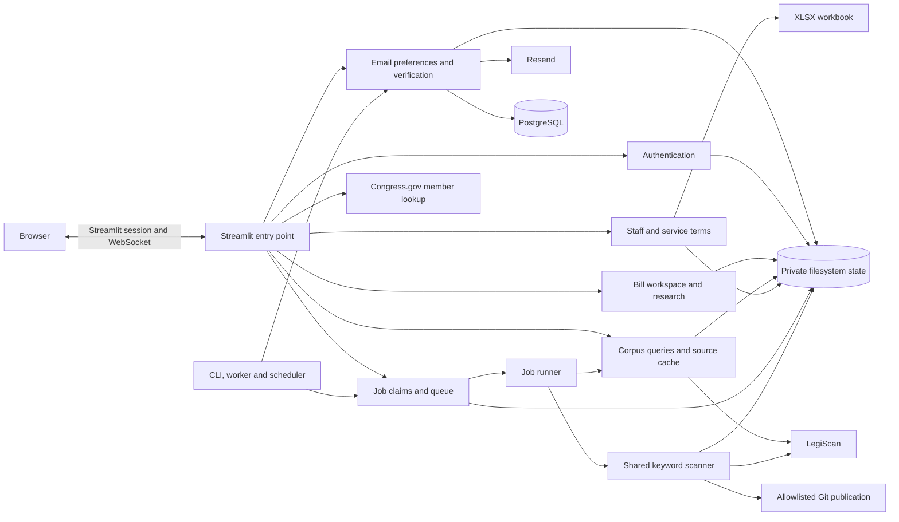

# Technical map

This map describes the running Python application and its rebuild boundaries. [README](../README.md) gives the installation and operating procedure. [installation.json](installation.json) exposes the entry points, configuration and commands for tooling. [techmap.json](techmap.json) inventories Python files, symbols, imports and direct call sites with source coordinates.

## Runtime and process map



### Entrypoints and module ownership

| Source | Responsibility and boundaries |
| --- | --- |
| [legiscan_git_sync_update_8_7.py](../legiscan_git_sync_update_8_7.py) | Current Streamlit entry point. Sidebar state, page dispatch, filters, billing cards, review and profile controls. Top-level code reruns during interaction. Manager factories and cached reads sit at the UI boundary. |
| [cli.py](../cli.py) | Headless parsing and exit codes. Executes sync, queue worker, PostgreSQL schema setup and a single email sweep. |
| [config.py](../config.py) | Resolves filesystem paths and shared LegiScan key when imported. The effective environment must exist before startup. |
| [auth.py](../auth.py) | Account file, password hashing, active Streamlit identity, roles, account settings, guest lifecycle and workspace directory resolution. |
| [corpus_manager.py](../corpus_manager.py) | LegiScan corpus API, bulk dataset ingest, incremental updates, SQLite queries, session coverage, roll-call fetch and identity candidates. |
| [legiscanner.py](../legiscanner.py) | Separate shared keyword scan, provider requests, keyword config, cache, and CSV generation. |
| [request_budget.py](../request_budget.py) | Tracks and limits LegiScan calls in the current job's budget context. |
| [job_manager.py](../job_manager.py) | SQLite job lifecycle, conflict detection, queue claim, heartbeat, recovery and retry. |
| [job_runner.py](../job_runner.py) | Coordinates sync operations with job progress, request budget and outcomes. Worker payload dispatch is consolidated here. |
| [staff_manager.py](../staff_manager.py) | Workbook validation, roster identity, preview/apply, snapshots, assignment observations and saved service terms. |
| [service_terms.py](../service_terms.py) | Official member lookup, input normalization and date/precision-aware term matching. |
| [bill_workspace.py](../bill_workspace.py) | Per-user transactional persistence, JSON recovery mirrors, tracking and note modifications, note recovery and attachment containment. |
| [bill_research.py](../bill_research.py) | Pure helpers for bill revisions, tracked changes, HTML diffs, topic matching and review queues. |
| [hearing_calendar.py](../hearing_calendar.py) | Normalizes bill event entries and emits date-only calendar data. |
| [notifications.py](../notifications.py) | Configuration, mailbox verification, status state transitions, transactional outbox, retry and provider submission. |
| [sync_github_repo.py](../sync_github_repo.py) | Git publication with explicit path checks and a pending-commit inspection. |
| [sync_staff_directory.py](../sync_staff_directory.py) and [staff_diagnostics.py](../staff_diagnostics.py) | Standalone staff operations and diagnostics with deployment assumptions. The reviewed import path is the admin UI. |
| [legiscan_comprehensive_tracker.py](../legiscan_comprehensive_tracker.py) and older `legiscan_git_sync_update*.py` | Existing alternate or older entry points. Retained in inventory for navigation and compatibility research. Deploy the current 8.7 entry point. |
| [tests](../tests) | Focused regressions for storage, source parsing, jobs, matching and email behavior. |
| [tools/generate_techmap.py](../tools/generate_techmap.py) | Generated source inventory and drift check. Standard library only. |

## Storage and identifiers

| Object | Owner and use |
| --- | --- |
| `DATA_DIR/users.json` | Auth account records. New users have durable opaque workspace IDs. Existing accounts keep their legacy resolution. Account records can contain user-supplied keys. |
| `DATA_DIR/workspaces/<workspace_id>/` and `DATA_DIR/users/<username>/` | New and legacy workspace locations. Guest paths are temporary. The email watcher resolves registered paths from the account store. |
| `.bill-workspace.sqlite3` per workspace | Filename-keyed workspace records backed by SQLite, with recovery copies of JSON files. Existing JSON-only data is read through compatibility handling. Preserve hidden files during backups. |
| Workspace JSON and uploads | Tracked IDs, notes, saved views, topics, review queue, profile notes and private attachments. Attachment access resolves beneath the current user's upload directory. |
| `DATA_DIR/bills.db` | `sessions`, `sync_meta`, `bills`, `bill_texts`, `keyword_matches`, `roll_calls`, `legislator_votes`, `people`, `people_mapping`, and calendar snapshots/attempts. |
| `DATA_DIR/staff.db` | Legislators, staff, issue and committee records, stable identity maps, roster snapshots, assignment history, service terms and import diagnostics. |
| `DATA_DIR/jobs.db` | `system_jobs`, including queued request payload, lifecycle, progress, recovery and claim information. |
| Shared CSV, `keywords.json`, `legiscan_cache.json` | Source for the shared keyword snapshot and related configuration/cache. Only the explicit CSV and global keywords are eligible for Git publication. |
| PostgreSQL `notification_preferences` | Preferences, verified recipient and verification state keyed by account owner. |
| PostgreSQL `notification_bill_status` | Latest notification baseline for an owner and watched bill. |
| PostgreSQL `notification_outbox` | Queued and attempted delivery, retry timing and provider response state. |

Use LegiScan bill IDs to join corpus, snapshots and watchlists. Use session ID plus jurisdiction to scope queries. Legislative numbers and display names are reusable labels. LegiScan people and roll-call IDs refer to provider identities and records. Staff profile IDs and roster identity tables are maintained locally. Congress.gov Bioguide IDs refer to official members. A verified mapping bridges these record domains. Any data export or cache keyed by a user must preserve account ownership across both workspace layouts.

## Workflows and call chains

### Authentication, workspace and private writes

1. The UI calls the auth renderer. `register_user`, `login_user`, or `login_as_guest` establishes the identity in Streamlit. Account updates use a serialized file update path and bcrypt for passwords. The first account receives the admin role.
2. The current identity selects `get_user_data_dir` or `get_guest_data_dir`. The UI builds file paths and then calls `load_bill_workspace`. It delegates to `read_workspace`, which looks up the SQLite workspace record and handles legacy JSON.
3. `change_tracking` delegates to `update_tracking`. Notes use `update_bill_note` and detect overlapping edits. `update_workspace` is the transactional mutation boundary. `publish_bill_workspace` and `export_workspace` handle recovery copies and related UI status.
4. Profile note changes and legacy reattachment are ownership-scoped. Attachment download resolves a requested reference through `resolve_attachment` before the UI serves it. Add screens using these helpers so reruns, older files and concurrent edits follow the same rules.

### Corpus ingestion and synchronous or queued jobs

1. The admin selects California and/or Congress. `sync_selected_sessions` and its current-session helper choose a session from the LegiScan feed. `get_active_sessions` requests `getSessionList`, with cached session rows for coverage and navigation.
2. The bootstrap path gets a dataset list and the dataset ZIP, then ingests provider bill, person and vote files. Optional per-bill fallback requests `getMasterListRaw` then `getBill`. Direct CLI bootstrap can use fallback. Admin bulk controls and the queue's bulk route disable it.
3. `refresh_session` requests the hash list, compares local rows and fetches changed bill records. Bill processing updates related calendar, text reference and vote data. `_process_bill_votes` and `_fetch_member_votes` retrieve missing eligible roll-call details. Successful partial updates can be reused by a retry. The freshness timestamp follows a successful full refresh.
4. `run_bootstrap_job`, `run_refresh_job`, `run_calendar_refresh`, and `run_rescan_job` report progress and outcomes in `JobManager`. The budget context records upstream LegiScan request usage within a job.
5. In background mode the UI calls `enqueue_job`. The CLI loops through `execute_next_job`, which claims an item with `claim_next_job`, updates heartbeat, dispatches according to job kind, and persists the outcome. Claims serialize conflicting ingestion work on an instance. The worker uses its own server credential and request environment.
6. Historical import begins only after an explicit session selection. `get_historical_coverage` queries imported state, freshness and completeness. Keep current auto-discovery and manually initiated historical work distinct when adding a scheduler.

### Search, review, amendments and events

- The current UI's database search uses `CorpusManager.search_bills` with pagination and search filters. Shared keyword results come through the CSV reader and scanner pipeline. The tracked view uses `get_tracked_bills_df` to reconcile IDs with available corpus and snapshot information.
- `find_topic_matches` applies scope and uses `parse_topic_rules` and `topic_match_reason`. Preserve match evidence, case-insensitive literal behavior, and the distinction between initial results and reviewed items when extending search.
- `bill_revision` creates the comparable review projection. `changed_fields` compares it with the saved baseline. `build_review_queue` combines actionable revisions, due follow-ups, unseen topic matches and calendar events. `update_review_item` persists review or snooze activity.
- `_show_bill_text_modal` and `render_amendment_comparison` request versions on demand. `CorpusManager` caches supported content retrieved through `getBillText`. `amendment_diff` uses visible HTML lines. A source document link can be present before a cached body.
- Calendar refresh stores successful snapshots and attempt state. `normalize_calendar` handles incoming entries and `export_calendar` emits date-only events. Use authoritative timezones if a future source provides them and preserve the date-only behavior for legacy feed rows.

### Staff, profile identity and service terms

1. Admin workbook preview enters `StaffManager.ingest_spreadsheet` with preview mode. Validation requires the expected tabs, and previews carry a roster revision. Apply a preview against the expected revision so an intervening roster change cannot silently overwrite it.
2. A committed roster operation uses persistent legislator and staff identity tables, stores a prior `staff_roster_snapshots` snapshot, and tracks observed assignment changes. `preview_roster_restore` and `restore_roster_snapshot` implement the analogous recovery flow with an expected revision.
3. `CorpusManager.sync_people_mapping` proposes local staff associations for LegiScan person IDs. Admins review identities through `list_vote_identities` and `review_vote_identity`. Profile views use mapped people and indexed individual votes. Keep manual verification and exclusions stable when regenerating candidates.
4. `fetch_congress_member_terms` queries Congress.gov's member endpoint for a verified Bioguide ID. `save_congress_service_terms` keeps terms at year precision. `save_exact_service_term` handles separately sourced dates. Streamlit filters profile votes by compatible terms. Keep source and precision with every stored term.


### Notification workflow and failure boundaries

1. The signed-in UI derives an owner with `account_owner` and configures `Notifications.from_environment`. `request_verification` normalizes the mailbox, rate-limits requests, and stores expiring verification state. It submits the code via `send_resend`. `verify` validates the code and `set_enabled` controls the preference.
2. `cli.py --task notifications` invokes `Notifications.process`. An advisory lock prevents simultaneous processing for the database. `read_notification_watchlists` reads account and private workspace membership. `snapshot_statuses` reads local bill state. This path does not call LegiScan.
3. `capture_status_changes` establishes baselines and creates outbox rows for eligible changes. Status normalization uses canonical provider codes. The baseline and outbox updates share a PostgreSQL transaction.
4. `deliver_pending` rechecks current account, preference, and tracked-bill eligibility. `send_resend` sends with a stable idempotency key. Provider acceptance and eventual delivery are separate events. Retry timing applies to transient failures. A resumed sender sees only the latest locally observed status where multiple changes occurred between sweeps.
5. Keep PostgreSQL backup and filesystem state coordinated. Email configuration and schedule are separate from corpus ingestion. Use an isolated sender during restore tests to prevent delivering a restored backlog.

### External operations

| Service | Input | Persistence and output | Operator control |
| --- | --- | --- | --- |
| LegiScan | API key, session or jurisdiction, dataset access key, bill or document IDs | SQLite corpus, cache and keyword snapshot | Dataset entitlements, job budget, cadence and selected sessions |
| Congress.gov | API key and member Bioguide ID | Sourced term records in staff storage | Verify identity before applying preview |
| Capitol Matrix Google Sheet | Built-in export URL or uploaded XLSX | Validated private roster and snapshot history | Preview counts and evidence, then confirm |
| Resend | Restricted sending key, verified from address, recipient, message and deduplication key | PostgreSQL state and Resend acceptance | Opt-in, sender schedule, domain verification and provider diagnostics |
| Git remote | Existing upstream and Git credentials | Allowlisted shared CSV and keywords | Explicit publication setup and private backup separation |

## Rebuild and extend safely

1. Rebuild the Python environment using [requirements.txt](../requirements.txt) on Python 3.12. Run the normal Streamlit command and the CLI from the source root. Confirm that each process computes the intended persistent paths.
2. Use a copy of real-world storage layouts in a protected test environment. Include a legacy account path, a new opaque workspace ID, JSON-only notes, a staff roster snapshot and a partially imported legislative session where available. Check upgrade and reverse migration before changing schemas.
3. For a new ingestion task, identify its UI, CLI, and queued entry points. Decide whether it should share the ingestion claim, provider budget, job outcomes and retry rules. Verify that restart and duplicate submissions are safe.
4. For new analytics, define the stable identifier, scope, precision, source provenance, completeness and freshness. Populate the data in the ingestion path and render from the local query path. If coverage varies by session, expose the missing-data state.
5. For new user state, use the account-scoped workspace helper and provide a strategy for older data. Validate ownership at reads, writes, exports and attachment opens. Keep saved user data outside publication.
6. For new alerts, define the event, observation baseline, ownership, delivery eligibility and retry behavior. Keep credentials and verification flows on the server and test failure windows with an injected transport.
7. Run the unit suite, use an isolated PostgreSQL integration database, and manually smoke-test affected Streamlit views. Verify start, restart and restore against the intended deployment. Regenerate the source map when Python files change.

## Programmatic inventory format

The generator parses root Python files plus files under `tests/` and `tools/`. It also inventories source retained for older entry points. Each file publishes a repository-relative path, module name, normalized-newline SHA-256, symbols, imports and calls. The inventory uses zero-based AST byte columns and one-based source lines. Function/method definitions include their signature, definition span, lexical owner, decorators, and async flag. Class records include bases. Lambdas receive a synthetic source-position identifier. A call listed under a module includes top-level dispatch statements, including code nested in branches.

- `lexical` gives a statically visible project definition or import candidate. It can be affected by conditional imports and runtime rebinding.
- `attribute_name_only` gives potential first-party methods with the same attribute name. Inspect the receiver type before treating a candidate as a dependency.
- `unresolved` preserves the expression and source location for calls without project resolution, including many builtins, external packages and dynamic calls.
- Runtime effects such as Streamlit callbacks passed as values, decorators, dynamic dispatch, SQL triggers or database behavior, downstream remote effects and asynchronous job scheduling require inspecting source and the workflow sections. Static parsing inventories syntax and does not execute the application.

Example queries from the checkout:

```sh
python tools/generate_techmap.py
python tools/generate_techmap.py --check
python -m json.tool docs/installation.json
```

To inspect call sites programmatically, load `docs/techmap.json`, then find files by `path`, symbols by `id`, and call sites by `caller` or candidate `targets`. To trace an inbound call to a method, inspect target lists and compare candidate resolution against the receiver in the source. For an operator's path, start in a workflow above; the raw graph includes tests and old entry points that do not participate in the deployed path.

## Verification coverage

- [Audit regression tests](../tests/test_audit_regressions.py) exercise focused app logic including staff import, historical coverage, job behavior, and private workflows.
- [Notifications tests](../tests/test_notifications.py) exercise status and mail helpers plus a PostgreSQL integration test with isolated state and a test transport when configured.
- [CI](../.github/workflows/regression.yml) installs dependencies on Python 3.12, configures PostgreSQL 16 and runs unittest. The repository has no deployment pipeline in that workflow. Production host and proxy behavior depend on the operator's environment.
